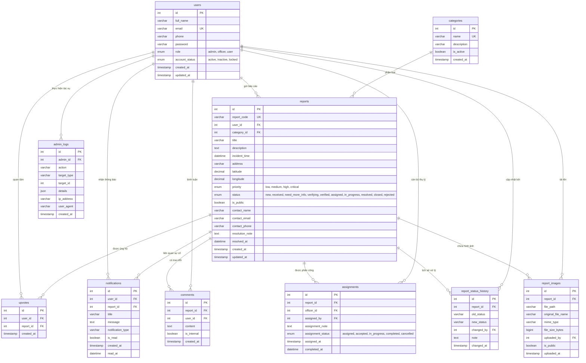

# Sơ đồ Cơ Sở Dữ Liệu (ERD) Chuẩn Hóa 10 Bảng - WarningInfo

Dưới đây là sơ đồ quan hệ thực thể (ERD) phiên bản chuẩn hóa cho hệ thống Báo cáo & Cảnh báo Sự cố Môi trường **WarningInfo**, tích hợp đầy đủ 10 bảng nghiệp vụ và tương thích hoàn toàn với kiến trúc Backend PHP OOP MVC.

---

## Danh mục 10 bảng nghiệp vụ:
1. **users:** Lưu tài khoản, phân quyền 3 cấp (`admin`, `officer`, `user`), trạng thái tài khoản.
2. **categories:** 7 danh mục sự cố môi trường chuẩn hóa theo thanh menu giao diện.
3. **reports:** Bảng sự cố trọng tâm, mã sự cố `report_code`, toạ độ GPS, 10 trạng thái và 4 mức ưu tiên.
4. **report_images:** Quản lý tệp ảnh/video minh chứng tải lên.
5. **report_status_history:** Ghi lại tiến trình thay đổi trạng thái từ lúc tiếp nhận đến khi xử lý xong.
6. **assignments:** Phân công trách nhiệm cho cán bộ môi trường thụ lý sự cố.
7. **notifications:** Gửi thông báo tự động cho người dân khi trạng thái báo cáo thay đổi.
8. **comments:** Trao đổi giữa người dân và cán bộ (hỗ trợ cờ nội bộ `is_internal`).
9. **admin_logs:** Nhật ký bảo mật lưu vết mọi tác vụ quản trị kèm dữ liệu JSON.
10. **upvotes:** Lượt xác nhận và quan tâm của cộng đồng (chống spam vote bằng UNIQUE).
