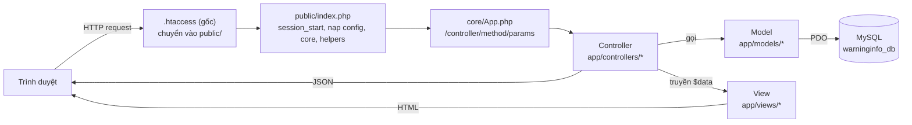
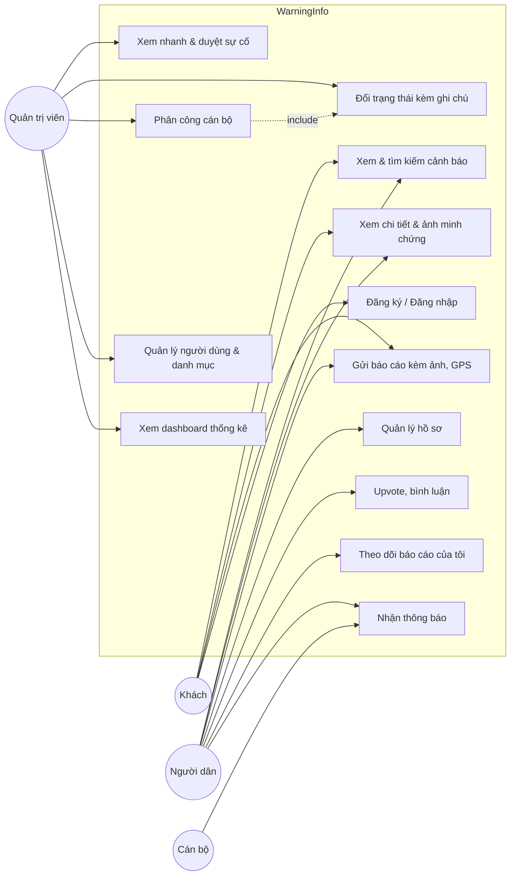
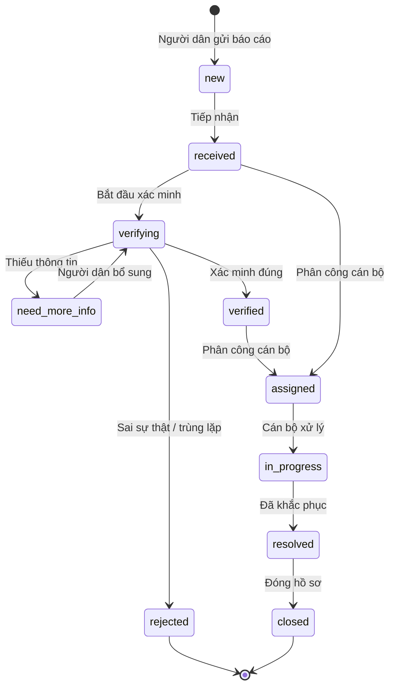
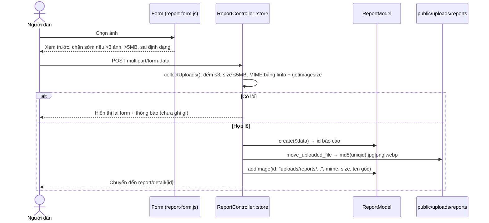
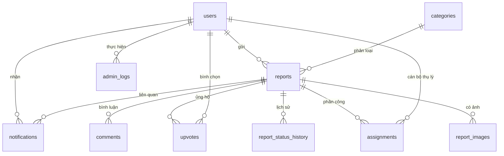

# TRƯỜNG ĐẠI HỌC KINH TẾ TP. HỒ CHÍ MINH (UEH)
## TRƯỜNG CÔNG NGHỆ VÀ THIẾT KẾ — KHOA CÔNG NGHỆ THÔNG TIN KINH DOANH

**Học phần:** Phát Triển Ứng Dụng Web
**Giảng viên hướng dẫn:** TS. Đặng Ngọc Hoàng Thành
**Đề tài:** WarningInfo — Hệ thống báo cáo & cảnh báo vấn đề môi trường
**Nhóm thực hiện:** Nhóm 11

| STT | Thành viên | Vai trò chính |
|:---:|:---|:---|
| 1 | Khiếu Hoàng Nam Anh | Team Lead, Backend Core (xác thực, hồ sơ, báo cáo của tôi) |
| 2 | Trần Yến Phượng | Backend Admin & Workflow (duyệt, lịch sử trạng thái, thông báo, phân công) |
| 3 | Lê Tô Nguyệt Minh | Backend Media & WebService (upload ảnh, API JSON) |
| 4 | Lê Trọng Hiếu | Frontend UI/UX & Responsive (form báo cáo, gallery, mobile) |
| 5 | Nguyễn Thế Luân | Frontend Admin, QA & Tài liệu (modal duyệt bài, báo cáo đồ án) |

> **Bản thảo Milestone 2.** Gồm Chương 1, Chương 2 và Chương 4. Chương 3 (Xây dựng & kiểm thử) và Chương 5 (Kết luận) sẽ bổ sung ở Milestone 3–4.
> Mọi mô tả trong tài liệu khớp với mã nguồn nhánh `develop`. Khi code thay đổi, cập nhật lại các mục có đánh dấu 📌.

---

## CHƯƠNG 1. TỔNG QUAN ĐỀ TÀI VÀ CÔNG NGHỆ

### 1.1. Lý do chọn đề tài

Các sự cố môi trường tại đô thị như rác thải đổ trộm, nước kênh đổi màu, khói bụi khu công nghiệp, ngập úng hay tiếng ồn ban đêm thường được người dân phát hiện sớm nhất. Tuy nhiên, kênh phản ánh hiện nay rời rạc (đường dây nóng, mạng xã hội, đơn giấy), khó theo dõi tiến độ và thiếu bằng chứng hình ảnh, vị trí chính xác. WarningInfo được xây dựng để:

- cho phép **người dân** gửi báo cáo nhanh, kèm ảnh minh chứng và toạ độ GPS;
- giúp **cơ quan quản lý** tiếp nhận, xác minh, phân công cán bộ và cập nhật tiến trình xử lý;
- **minh bạch hoá** kết quả xử lý để cộng đồng cùng theo dõi và xác nhận (upvote, bình luận).

### 1.2. Mục tiêu

| Nhóm mục tiêu | Nội dung |
|:---|:---|
| Sản phẩm | Hoàn thiện luồng nghiệp vụ: *Người dân gửi báo cáo (ảnh + vị trí) → Admin tiếp nhận, xác minh → Phân công cán bộ → Cập nhật trạng thái kèm thông báo → Người dân theo dõi phản hồi*. |
| Kỹ thuật | PHP thuần hướng đối tượng theo mô hình MVC; PDO prepared statement; kiểm soát dữ liệu đầu vào; upload file an toàn; WebService JSON phục vụ AJAX. |
| Quản lý dự án | Mỗi thành viên có Issue, nhánh Git và Pull Request riêng; quy trình `feature/* → develop → main`. |

### 1.3. Phạm vi và đối tượng sử dụng

| Vai trò (`users.role`) | Mô tả |
|:---|:---|
| Khách (chưa đăng nhập) | Xem trang chủ, danh sách và chi tiết cảnh báo công khai; gửi báo cáo ẩn danh (có thể để lại thông tin liên hệ). |
| Người dân (`user`) | Toàn bộ quyền của khách, cộng thêm: đăng ký/đăng nhập, quản lý hồ sơ, xem "Báo cáo của tôi", upvote, bình luận. |
| Cán bộ (`officer`) | Được Admin phân công thụ lý sự cố và nhận thông báo giao việc. 📌 Giao diện riêng cho cán bộ thuộc kế hoạch Milestone 3. |
| Quản trị viên (`admin`) | Dashboard thống kê; quản lý sự cố (xem nhanh, đổi trạng thái kèm ghi chú, phân công cán bộ); quản lý người dùng, phân quyền và danh mục. |

### 1.4. Công nghệ sử dụng

| Lớp | Công nghệ | Vai trò trong dự án |
|:---|:---|:---|
| Giao diện | HTML5, CSS3, Bootstrap 5.3, Bootstrap Icons, font Be Vietnam Pro | Bố cục responsive, component (modal, badge, form). CSS tách theo trang trong `public/assets/css/`. |
| Tương tác client | JavaScript thuần, jQuery 3.7 | Xem trước ảnh trước khi gửi, lấy GPS (`navigator.geolocation`), lightbox gallery, upvote AJAX, modal quản trị. |
| Máy chủ | PHP 8 (OOP), Apache `mod_rewrite` | Front controller `public/index.php`, router `core/App.php`, Controller/Model/View tự xây dựng. |
| Cơ sở dữ liệu | MySQL / MariaDB, `utf8mb4_unicode_ci` | 10 bảng quan hệ, khoá ngoại, chỉ mục cho truy vấn lọc. |
| Truy cập dữ liệu | PDO với prepared statement (`core/Database.php`) | Chống SQL Injection, ánh xạ kết quả thành đối tượng (`FETCH_OBJ`). |
| WebService | JSON qua HTTP GET (`/report/api_list`), POST (`/report/upvote/{id}`) | Cung cấp dữ liệu cho AJAX, bản đồ, ứng dụng bên thứ ba. |
| Môi trường & cộng tác | XAMPP, Git/GitHub (Issue template, nhánh theo thành viên) | Chạy local, quản lý mã nguồn và tiến độ. |

### 1.5. Kiến trúc tổng thể

Hệ thống theo mô hình **Client – Server**, phía server tổ chức theo **MVC**:



- **Định tuyến:** URL `/{controller}/{method}/{tham số}`, ví dụ `report/detail/5` gọi `ReportController::detail(5)`. URL trống hoặc controller không tồn tại sẽ dùng `HomeController::index`.
- **Thư mục:**

```
config/config.php        Hằng số DB_*, URLROOT, APPROOT, múi giờ
core/                    App (router), Controller (model(), view()), Database (PDO)
app/controllers/         Home, Auth, Report, Admin
app/models/              UserModel, CategoryModel, ReportModel, NotificationModel
app/helpers/             auth_helper (isLoggedIn, requireAdmin, flash), view_helper (e, url, asset, redirect)
app/views/               layouts/, home/, reports/, auth/, admin/
public/                  index.php, assets/ (css, js, img), uploads/reports/
database/                database_init.sql, ERD.md
```

---

## CHƯƠNG 2. PHÂN TÍCH VÀ THIẾT KẾ HỆ THỐNG

### 2.1. Yêu cầu chức năng

| Mã | Chức năng | Tác nhân | Đường dẫn | Trạng thái 📌 |
|:---|:---|:---|:---|:---:|
| F01 | Đăng ký, đăng nhập, đăng xuất | Khách, Người dân | `auth/register`, `auth/login`, `auth/logout` | ✅ |
| F02 | Cập nhật hồ sơ, đổi mật khẩu | Người dân | `auth/profile` | ✅ |
| F03 | Xem trang chủ: thống kê, danh mục, sự cố mới | Mọi người | `/` | ✅ |
| F04 | Danh sách cảnh báo, tìm kiếm & lọc (danh mục, mức độ, trạng thái) | Mọi người | `report` | ✅ |
| F05 | Xem chi tiết sự cố, gallery ảnh, lịch sử xử lý | Mọi người | `report/detail/{id}` | ✅ |
| F06 | Gửi báo cáo kèm tối đa 3 ảnh, GPS, liên hệ | Khách, Người dân | `report/create` → `report/store` | ✅ |
| F07 | Upvote ("Tôi cũng thấy sự cố này") – AJAX | Người dân | `POST report/upvote/{id}` | ✅ |
| F08 | Bình luận / phản hồi | Mọi người | `POST report/comment/{id}` | ✅ |
| F09 | Báo cáo của tôi & thống kê cá nhân | Người dân | `report/my_reports` | ✅ |
| F10 | WebService danh sách sự cố (JSON) | Ứng dụng client | `GET report/api_list` | ✅ |
| F11 | Dashboard thống kê | Admin | `admin` | ✅ |
| F12 | Xem nhanh sự cố (modal + ảnh) | Admin | `admin/reports` | ✅ |
| F13 | Đổi trạng thái kèm ghi chú, ghi lịch sử, gửi thông báo | Admin | `POST admin/updateReportStatus/{id}` | ✅ |
| F14 | Phân công cán bộ thụ lý | Admin | `POST admin/assignOfficer/{id}` | ✅ |
| F15 | Quản lý người dùng & phân quyền | Admin | `admin/users` | ✅ |
| F16 | Quản lý danh mục (CRUD) | Admin | `admin/categories` | ✅ |
| F17 | Hộp thông báo cho người dân / cán bộ | Người dân, Cán bộ | — | ⏳ M3 |
| F18 | Bản đồ sự cố, lọc AJAX không tải lại trang | Mọi người | — | ⏳ M3 |

### 2.2. Yêu cầu phi chức năng

- **Bảo mật**
  - Mật khẩu băm bằng `password_hash` (bcrypt).
  - Toàn bộ truy vấn dùng PDO prepared statement.
  - Dữ liệu người dùng in ra HTML qua hàm `e()` (`htmlspecialchars`) để chống XSS.
  - Trang quản trị được bảo vệ bằng `requireAdmin()`.
  - Các giá trị `status`/`priority` được kiểm tra theo danh sách ENUM hợp lệ.
  - Upload: kiểm tra MIME bằng nội dung file, tên file ngẫu nhiên, cấm thực thi mã trong `public/uploads/` (xem 2.6).
- **Khả dụng:** Giao diện responsive ở các mốc 375 / 414 / 768 px (ảnh chụp trong `docs/screenshots/`). Thông báo flash bằng tiếng Việt cho mọi thao tác.
- **Toàn vẹn dữ liệu:** Khoá ngoại với `ON DELETE CASCADE / SET NULL / RESTRICT` phù hợp từng quan hệ. Ví dụ, không xoá được danh mục khi đang có báo cáo dùng nó.
- **Hiệu năng:** Có chỉ mục cho các truy vấn lọc theo trạng thái, danh mục, mức độ và thời gian. Ảnh của nhiều báo cáo trên trang Admin được lấy bằng **một** truy vấn `IN (...)`.

### 2.3. Sơ đồ Use Case



> Người dân kế thừa toàn bộ chức năng của Khách. Phân công cán bộ (UC11) **bao gồm** việc chuyển trạng thái sang *Đã phân công* (UC10).

### 2.4. Đặc tả một số Use Case chính

**UC3 – Gửi báo cáo sự cố**

| Mục | Nội dung |
|:---|:---|
| Tác nhân | Khách hoặc Người dân |
| Tiền điều kiện | Không bắt buộc đăng nhập. Nếu đã đăng nhập, báo cáo gắn với `user_id` và tự điền tên, email liên hệ. |
| Luồng chính | 1) Mở `report/create`. 2) Nhập tiêu đề, chọn danh mục, mức độ, mô tả. 3) Nhập địa chỉ, bấm "Lấy GPS hiện tại" (tuỳ chọn). 4) Chọn 1–3 ảnh, xem trước ngay trên form. 5) Gửi. 6) Hệ thống kiểm tra dữ liệu và ảnh, tạo `report_code` dạng `WI-YYYYMMDD-XXXX`, lưu báo cáo với trạng thái `new`, lưu ảnh vào `public/uploads/reports/` và bảng `report_images`. 7) Chuyển đến trang chi tiết báo cáo vừa tạo. |
| Luồng ngoại lệ | Thiếu tiêu đề, danh mục hoặc mô tả; quá 3 ảnh; ảnh trên 5MB; file không phải JPG/PNG/WEBP. Khi đó form hiển thị lại kèm thông báo lỗi tại trường tương ứng, nội dung chữ đã nhập được giữ lại (ảnh phải chọn lại do giới hạn bảo mật của trình duyệt), và **chưa có gì được ghi vào CSDL**. |
| Hậu điều kiện | Báo cáo xuất hiện trong danh sách công khai và trang Admin. |

**UC11 – Phân công cán bộ thụ lý**

| Mục | Nội dung |
|:---|:---|
| Tác nhân | Quản trị viên |
| Tiền điều kiện | Đã đăng nhập với vai trò `admin`. Sự cố chưa ở trạng thái kết thúc (`resolved`, `closed`, `rejected`). |
| Luồng chính | 1) Tại `admin/reports`, bấm nút *Phân công* trên dòng sự cố. 2) Modal hiển thị mã và tiêu đề sự cố. Chọn cán bộ (tài khoản `officer`/`admin` đang hoạt động) và nhập ghi chú giao việc. 3) Xác nhận. 4) Hệ thống huỷ các phân công cũ còn hiệu lực, ghi bản ghi mới vào `assignments`, chuyển trạng thái sự cố sang `assigned` (ghi `report_status_history`), rồi tạo thông báo cho cán bộ và người gửi. |
| Luồng ngoại lệ | Cán bộ không hợp lệ, sự cố không tồn tại hoặc đã kết thúc. Khi đó hệ thống báo lỗi và không ghi dữ liệu. |

### 2.5. Quy trình xử lý sự cố (Workflow trạng thái)

Trường `reports.status` có 10 giá trị. Admin có thể chuyển giữa các trạng thái. Mỗi lần chuyển đều được ghi lịch sử và tạo thông báo cho người gửi.



| Giá trị | Nhãn hiển thị | Ô thống kê trên Dashboard (`ReportModel::getStats`) |
|:---|:---|:---|
| `new` | Mới tiếp nhận | — |
| `received` | Đã tiếp nhận | Đang xử lý |
| `need_more_info` | Cần bổ sung thông tin | — |
| `verifying` | Đang xác minh | Đang xử lý |
| `verified` | Đã xác minh | — |
| `assigned` | Đã phân công cán bộ | Đang xử lý |
| `in_progress` | Đang xử lý | Đang xử lý |
| `resolved` | Đã khắc phục | Đã giải quyết |
| `closed` | Đã đóng | Đã giải quyết |
| `rejected` | Bị từ chối | — |

> 📌 Hiện `getStats()` (Dashboard) và `getUserStats()` (Báo cáo của tôi) nhóm trạng thái chưa thống nhất: `getUserStats` tính cả `new` là "đang xử lý". Nhóm nên chốt một quy tắc chung.

Mức độ ưu tiên (`priority`): `low` (Thấp), `medium` (Trung bình), `high` (Cao), `critical` (Nghiêm trọng).

### 2.6. Thiết kế chức năng upload ảnh minh chứng



Các lớp bảo vệ:

1. Kiểm tra lại ở server, vì kiểm tra phía client có thể bị bỏ qua.
2. MIME được xác định từ nội dung file, không tin `$_FILES['type']` do trình duyệt gửi.
3. Đuôi file lấy theo MIME thật, tên file sinh ngẫu nhiên, nên không thể tải lên file `.php`.
4. File `public/uploads/.htaccess` tắt PHP, chặn các đuôi thực thi và không cho liệt kê thư mục.
5. Ảnh người dùng tải lên không được commit lên Git (cấu hình trong `.gitignore`).

### 2.7. Thiết kế WebService `GET /report/api_list`

- **Tham số (tuỳ chọn):** `category_id`, `priority`, `status`, `q` (từ khoá trong tiêu đề, mô tả, địa chỉ). Giá trị không hợp lệ sẽ bị bỏ qua.
- **Phản hồi:** `Content-Type: application/json; charset=utf-8`. Chỉ trả báo cáo công khai (`is_public = 1`) và **không** trả email/SĐT người gửi.

```json
{
  "status": "success",
  "count": 1,
  "filters": { "priority": "critical" },
  "data": [{
    "id": 2, "report_code": "WI-20261002-0002",
    "title": "Khói đen phát ra từ khu xưởng",
    "category_id": 3, "category_name": "Ô nhiễm không khí",
    "priority": "critical", "status": "verifying", "status_label": "Đang xác minh",
    "address": "KCN Tân Bình, Tân Phú, TP. Hồ Chí Minh",
    "latitude": 10.8231, "longitude": 106.6297,
    "upvote_count": 2, "comment_count": 1,
    "thumbnail_url": null,
    "detail_url": "http://localhost/Group11_Project-Web_WarningInfo/report/detail/2",
    "incident_time": "2026-10-02 16:15:00", "created_at": "2026-10-18 14:42:56"
  }]
}
```

- Phương thức khác `GET` nhận về `405`.

---

## CHƯƠNG 4. THIẾT KẾ CƠ SỞ DỮ LIỆU

### 4.1. Tổng quan

- Tên CSDL: `warninginfo_db`, engine InnoDB, bảng mã `utf8mb4_unicode_ci` (hỗ trợ đầy đủ tiếng Việt và emoji).
- Script khởi tạo: `database/database_init.sql`. Script tạo 10 bảng và dữ liệu mẫu gồm 5 tài khoản, 7 danh mục và 5 báo cáo.
- Sơ đồ ERD chi tiết (Mermaid): `database/ERD.md`.

### 4.2. Sơ đồ quan hệ (rút gọn)



### 4.3. Mô tả các bảng

**`users`**: tài khoản và phân quyền

| Cột | Kiểu | Ràng buộc / Ý nghĩa |
|:---|:---|:---|
| id | INT | PK, tự tăng |
| full_name | VARCHAR(150) | Họ tên |
| email | VARCHAR(190) | UNIQUE, dùng để đăng nhập |
| phone | VARCHAR(30) | Số điện thoại (tuỳ chọn) |
| password | VARCHAR(255) | Hash bcrypt |
| role | ENUM('admin','officer','user') | Mặc định `user` |
| account_status | ENUM('active','inactive','locked') | Chỉ tài khoản `active` được phân công |
| created_at, updated_at | TIMESTAMP | |

**`categories`**: 7 danh mục sự cố (`name` UNIQUE, `description`, `is_active`).

**`reports`**: bảng trung tâm

| Cột | Kiểu | Ràng buộc / Ý nghĩa |
|:---|:---|:---|
| id | INT | PK |
| report_code | VARCHAR(30) | UNIQUE, dạng `WI-YYYYMMDD-XXXX` |
| user_id | INT NULL | FK → users, `SET NULL` khi xoá user (cho phép báo cáo ẩn danh) |
| category_id | INT | FK → categories, `RESTRICT` |
| title, description | VARCHAR(200), TEXT | Bắt buộc |
| incident_time | DATETIME | Thời điểm xảy ra |
| address, latitude, longitude | VARCHAR(500), DECIMAL(10,7) | Vị trí hiện trường |
| priority | ENUM 4 mức | Mặc định `medium` |
| status | ENUM 10 trạng thái | Mặc định `new` (xem 2.5) |
| is_public | BOOLEAN | Có hiển thị công khai hay không |
| contact_name / email / phone | | Thông tin liên hệ, chỉ Admin xem |
| resolution_note, resolved_at | | Kết quả xử lý |

Chỉ mục: `(status, created_at)`, `(category_id, created_at)`, `(priority, status)`, `(latitude, longitude)`.

**`report_images`**: `report_id` (FK, CASCADE), `file_path` (đường dẫn tương đối, ví dụ `uploads/reports/<md5>.jpg`), `original_file_name`, `mime_type`, `file_size_bytes`, `uploaded_by` (FK users, SET NULL), `is_public`, `uploaded_at`.

**`report_status_history`**: `report_id`, `old_status`, `new_status`, `changed_by` (FK users), `note` (ghi chú/lý do do Admin nhập), `changed_at`. Mỗi lần đổi trạng thái sinh một dòng.

**`assignments`**: `report_id`, `officer_id` (FK users, RESTRICT), `assigned_by`, `assignment_note`, `assignment_status` ENUM('assigned','accepted','in_progress','completed','cancelled'), `assigned_at`, `completed_at`. Quy ước: mỗi sự cố chỉ có **một** phân công còn hiệu lực. Khi phân công lại, bản cũ chuyển thành `cancelled`.

**`notifications`**: `user_id` (người nhận), `report_id`, `title`, `message`, `notification_type` (`report_status`, `assignment`, …), `is_read`, `created_at`, `read_at`.

**`comments`**: `report_id`, `user_id` (NULL nếu ẩn danh), `content`, `is_internal` (trao đổi nội bộ cán bộ), `created_at`.

**`upvotes`**: `user_id`, `report_id`, UNIQUE(`user_id`, `report_id`) để mỗi người chỉ vote một lần. Bấm lại sẽ huỷ vote.

**`admin_logs`**: `admin_id`, `action`, `target_type`, `target_id`, `details` (JSON), `ip_address`, `user_agent`. 📌 Đã có bảng, chưa ghi log trong code (Milestone 3).

### 4.4. Ánh xạ Model – Bảng

| Model | Bảng thao tác | Phương thức tiêu biểu |
|:---|:---|:---|
| `UserModel` | users | `findByEmail`, `create`, `updateProfile`, `updatePassword`, `updateRole`, `getOfficers` |
| `CategoryModel` | categories | `getAll`, `create`, `update`, `delete`, `nameExists` |
| `ReportModel` | reports, report_images, report_status_history, assignments, comments, upvotes | `getAll($filters)`, `getById`, `create`, `addImage`, `updateStatus`, `assignOfficer`, `toggleUpvote`, `getStats` |
| `NotificationModel` | notifications | `create`, `getByUser`, `countUnread`, `markAsRead`, `statusLabel` |

### 4.5. Dữ liệu mẫu và tài khoản thử nghiệm

| Email | Mật khẩu | Vai trò |
|:---|:---|:---|
| admin@warninginfo.com | `password` | admin |
| officer@warninginfo.com | `password` | officer |
| an.demo@warninginfo.local, binh.demo@…, cuong.demo@… | `password` | user |

> Cần đổi mật khẩu các tài khoản mẫu trước khi triển khai lên hosting (Milestone 4).
