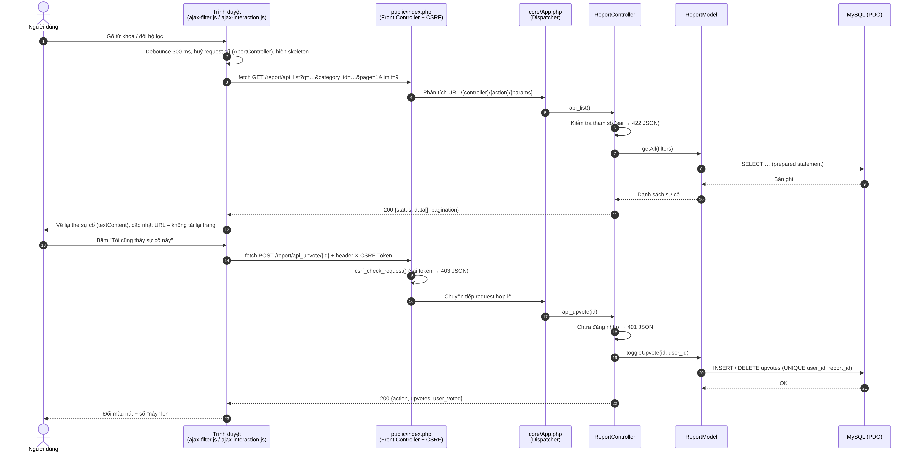
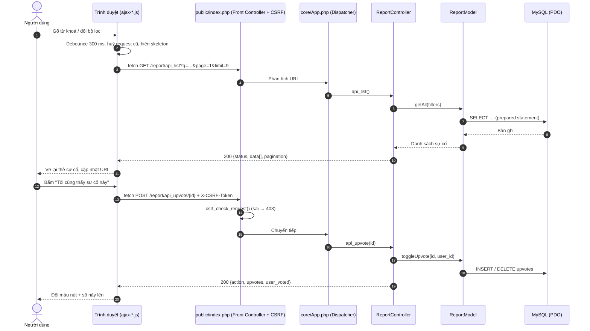

# CHƯƠNG 5 (phần TV5). WEBSERVICE RESTful, AJAX & KIỂM THỬ HỆ THỐNG

> **Nhánh:** `feature/tv5-ajax-core-and-docs`. Issue #23 (AJAX) và Issue #27 (Chương 5 + kiểm thử chéo).
> Phần bản đồ Leaflet + `api_geojson` nằm ở `docs/CHUONG_5_BAN_DO_LEAFLET.md` (TV1). Khi ghép vào bản Word, đánh số lại mục cho khớp.
> Ngày kiểm thử: 08/11/2026.

---

## 5.1. Kiến trúc WebService RESTful

### 5.1.1. Nguyên tắc chung

WebService **không** tách ra một ứng dụng riêng mà dùng lại đúng bộ khung MVC của website. Mỗi endpoint là một *action* có tiền tố `api_` trong Controller, nên request vẫn đi qua các bước sau:

1. **Front Controller** `public/index.php`: nạp cấu hình và helper, sau đó gọi `csrf_check_request()` cho **mọi** request POST.
2. **Dispatcher** `core/App.php`: tách URL `/{controller}/{action}/{params}` và gọi action tương ứng.
3. **Controller**: kiểm tra phương thức HTTP, quyền truy cập và tham số, rồi gọi Model.
4. **Model**: truy vấn MySQL bằng PDO prepared statement, chống SQL Injection.
5. Controller trả về **JSON** (`Content-Type: application/json; charset=utf-8`), riêng `api_xml_feed` trả **XML**.

**Quy ước phản hồi:**

| Trường hợp | Mã HTTP | Thân phản hồi |
|:---|:-:|:---|
| Thành công | `200` (tạo mới: `201`) | `{"status": "success", ...}` |
| Sai phương thức (vd. GET vào API chỉ nhận POST) | `405` | `{"status": "error", "message": "..."}` |
| Chưa đăng nhập | `401` | như trên |
| Thiếu / sai mã CSRF | `403` | như trên |
| Không tìm thấy, hoặc sự cố không công khai | `404` | như trên |
| Tham số không hợp lệ | `422` | như trên |

Dữ liệu cá nhân của người gửi (email, số điện thoại) **không bao giờ** xuất hiện trong phản hồi API công khai.

### 5.1.2. Danh mục endpoint

| # | Phương thức & URL | Quyền | Mô tả | Phụ trách |
|:-:|:---|:---|:---|:-:|
| 1 | `GET /report/api_list` | Công khai | Danh sách sự cố công khai: lọc, tìm kiếm, phân trang | TV3 |
| 2 | `GET /report/api_geojson` | Công khai | Sự cố có toạ độ theo chuẩn GeoJSON cho bản đồ (xem tài liệu của TV1) | TV1 |
| 3 | `POST /report/api_upvote/{id}` | Đăng nhập | Bật / tắt xác nhận "Tôi cũng thấy sự cố này" | TV3 |
| 4 | `GET /report/api_comments/{id}` | Công khai | Bình luận công khai của 1 sự cố, phân trang | TV3, TV5 |
| 5 | `POST /report/api_add_comment` | Đăng nhập | Gửi bình luận, trả lại bình luận vừa tạo | TV3, TV5 |
| 6 | `GET /report/api_xml_feed` | Công khai | Bản tin sự cố dạng XML | TV3 |
| 7 | `GET /notification/latest` | Đăng nhập | Số thông báo chưa đọc + 6 thông báo mới nhất (chuông) | TV4 |
| 8 | `POST /notification/read/{id}` | Đăng nhập | Đánh dấu 1 thông báo đã đọc | TV4 |
| 9 | `POST /notification/readAll` | Đăng nhập | Đánh dấu tất cả đã đọc | TV4 |
| 10 | `GET /admin/api_statistics` | Admin | Số liệu cho biểu đồ Chart.js ở Dashboard | TV2 |

### 5.1.3. Đặc tả chi tiết

#### (1) `GET /report/api_list`

| Tham số | Kiểu | Mô tả |
|:---|:---|:---|
| `q` hoặc `keyword` | `string` | Tìm trong tiêu đề, mô tả, địa chỉ |
| `category_id` | `int` hoặc danh sách `1,2` | Danh mục |
| `priority` | `low \| medium \| high \| critical` | Mức độ nghiêm trọng |
| `status` | 1 trong 10 trạng thái (`new`, `verifying`, `in_progress`, `resolved`, …) | Trạng thái xử lý |
| `from_date`, `to_date` | `YYYY-MM-DD` | Khoảng ngày xảy ra sự cố |
| `page` | `int ≥ 1` (mặc định 1) | Trang |
| `limit` | `int` 1–100 (mặc định 10) | Số bản ghi mỗi trang |

Lỗi `422` khi `priority` / `status` không hợp lệ, ngày sai định dạng, hoặc `from_date` > `to_date`.

```json
{
  "status": "success",
  "data": [{
    "id": 2, "report_code": "WI-20261001-0002", "title": "Khói đen phát ra từ khu xưởng",
    "description": "…", "category_id": 3, "category_name": "Ô nhiễm không khí",
    "priority": "critical", "status": "verifying", "status_label": "Đang xác minh",
    "address": "…", "latitude": 10.80, "longitude": 106.66,
    "upvote_count": 1, "comment_count": 1, "thumbnail_url": null,
    "detail_url": "http://localhost/Group11_Project-Web_WarningInfo/report/detail/2",
    "incident_time": "2026-10-02 08:30:00", "created_at": "…"
  }],
  "pagination": { "total": 1, "page": 1, "limit": 9, "total_pages": 1 }
}
```

#### (3) `POST /report/api_upvote/{id}`

- **Header bắt buộc:** `X-CSRF-Token: <mã trong thẻ <meta name="csrf-token">>`.
- **Phản hồi:** `{"status": "success", "action": "upvoted" | "unvoted", "upvotes": 3, "user_voted": true}`.
- **Lỗi:** `401` chưa đăng nhập · `403` sai mã CSRF · `404` sự cố không tồn tại hoặc không công khai · `405` không phải POST.
- **Toàn vẹn dữ liệu:** bảng `upvotes` có ràng buộc `UNIQUE (user_id, report_id)`, nên mỗi người chỉ được tính 1 lượt kể cả khi bấm liên tục.

#### (4) `GET /report/api_comments/{id}?page=&limit=`

Trả về bình luận **công khai** (`is_internal = 0`), mới nhất trước. `limit` từ 1 đến 50, mặc định 10.

```json
{
  "status": "success",
  "data": [{ "id": 3, "content": "…", "user_name": "Nguyễn Minh An", "is_staff": false,
             "created_at": "2026-11-08 07:43:17", "created_at_text": "07:43 08/11/2026" }],
  "pagination": { "page": 2, "limit": 5, "total": 6, "total_pages": 2, "has_more": false }
}
```

#### (5) `POST /report/api_add_comment`

- **Thân (JSON):** `{"report_id": 1, "content": "Nội dung"}` (cũng nhận form-urlencoded).
- **Phản hồi `201`:** `{"status": "success", "message": "Đã gửi bình luận.", "comment": {…như trên…}, "total": 3}`.
- **Lỗi:** `401` · `403` · `404` · `422` (nội dung rỗng hoặc dài hơn 5000 ký tự).

#### (6) `GET /report/api_xml_feed`

```xml
<?xml version="1.0" encoding="UTF-8"?>
<reports>
  <report><id>1</id><title>Nước kênh đổi màu bất thường</title><description>…</description>
          <status>received</status><created_at>…</created_at></report>
</reports>
```

---

## 5.2. Tích hợp AJAX ở giao diện người dân (Issue #23)

### 5.2.1. Thành phần mã nguồn

| Tầng | Tệp | Vai trò |
|:---|:---|:---|
| Client | `public/assets/js/ajax-filter.js` | Lọc / tìm kiếm / "Xem thêm" ở `/report` không tải lại trang |
| Client | `public/assets/js/ajax-interaction.js` | Upvote, gửi bình luận, "Tải thêm bình luận", đánh dấu đã đọc thông báo |
| Client | `public/assets/css/components.css` (mục *Hiệu ứng AJAX*) | Skeleton, hiệu ứng số nảy, xuất hiện mờ dần |
| View | `reports/index.php`, `reports/_card.php`, `reports/detail.php`, `notifications/index.php` | Gắn `id` / `data-*` (URL API, kích thước trang, bảng nhãn badge) cho JS |
| Controller | `ReportController::index()`, `detail()`, `api_comments()`, `api_add_comment()` | Phân trang trang đầu, trả bình luận vừa tạo |
| Model | `ReportModel`: `PRIORITY_BADGES`, `STATUS_BADGES`, `getPublicComments()`, `countPublicComments()`, `getCommentById()`, `hasUpvoted()` | Truy vấn và bảng nhãn dùng chung |

### 5.2.2. Sơ đồ tuần tự luồng gọi AJAX



<details><summary>Mã Mermaid (GitHub tự vẽ)</summary>


</details>

### 5.2.3. Lọc sự cố không tải lại trang (`ajax-filter.js`)

- **Kích hoạt:** gõ vào ô tìm kiếm (debounce 300 ms, nên gõ "kênh" chỉ sinh 1 request thay vì 4); đổi danh mục / mức độ / trạng thái; bấm "Lọc" hoặc nút đặt lại.
- **Trong lúc chờ:** hiện 6 thẻ khung xương (skeleton) và đặt `aria-busy="true"` cho vùng kết quả.
- **Chống ghi đè kết quả:** dùng `AbortController` huỷ request cũ khi người dùng đổi bộ lọc liên tục, để kết quả về sau không đè lên kết quả mới.
- **"Xem thêm sự cố":** nạp trang kế tiếp (9 thẻ một lần) và nối vào cuối danh sách.
- **URL luôn khớp bộ lọc** (`history.replaceState`): F5 hoặc chia sẻ link vẫn giữ nguyên kết quả.
- **Hoạt động khi tắt JS:** form vẫn gửi GET bình thường, nút "Xem thêm" là link `?page=2` do `ReportController::index()` xử lý.
- **Một nguồn nhãn duy nhất:** nhãn và màu badge lấy từ `ReportModel::PRIORITY_BADGES` / `STATUS_BADGES`. PHP dùng để render thẻ trong `_card.php`, đồng thời truyền sang JS qua `data-badges`, nên thẻ render bằng PHP và bằng AJAX luôn giống nhau.

### 5.2.4. Tương tác ở trang chi tiết (`ajax-interaction.js`)

- **Upvote:** nút đổi sang màu đặc kèm biểu tượng 👍 đầy và chữ "Bạn đã xác nhận", con số nảy lên (`.number-bounce`). Khi mở trang, nút đã hiện đúng trạng thái nhờ `ReportModel::hasUpvoted()`. Khách chưa đăng nhập được nhắc và chuyển tới trang đăng nhập.
- **Gửi bình luận:** bình luận mới chèn lên đầu danh sách, có viền nhấn, và số "Phản hồi & Thảo luận (n)" tăng theo. Lỗi (rỗng, quá 5000 ký tự, hết phiên) hiện bằng toast tiếng Việt.
- **"Tải thêm bình luận (n)":** trang đầu có 5 bình luận render sẵn bằng PHP, các trang sau nạp qua `api_comments`. Bình luận vừa gửi làm lệch vị trí phân trang (OFFSET), nên JS bỏ qua các `id` đã hiển thị để không bị trùng.
- **Ghi chú nội bộ** của cán bộ (`is_internal = 1`) tách thành khối riêng, chỉ cán bộ / admin thấy, không bao giờ trả qua API công khai.

### 5.2.5. Đánh dấu đã đọc thông báo

Ở trang `/notification`, nút ✓ trên từng thông báo và nút "Đánh dấu tất cả đã đọc" gửi AJAX tới `notification/read/{id}` / `readAll`. Thông báo đổi sang trạng thái đã đọc ngay, dòng tổng kết và số trên tab "Chưa đọc" cập nhật theo. JS phát sự kiện `wi:notifications-changed` để chuông trên thanh menu (`notifications.js`) tải lại số chưa đọc. Ở tab "Chưa đọc", thông báo vừa đọc mờ dần rồi biến mất.

### 5.2.6. Bảo mật phía client

| Rủi ro | Biện pháp |
|:---|:---|
| **XSS** qua nội dung người dùng (tiêu đề, mô tả, bình luận) | Mọi dữ liệu từ API được gán bằng `textContent` / `createElement`, không dùng `innerHTML`. Đã thử bình luận `` và `<script>`: hiển thị nguyên văn, không thực thi |
| **CSRF** | Mọi `fetch` POST gửi header `X-CSRF-Token` qua `WI.csrfHeaders()` (main.js). Server chặn ở `public/index.php` |
| Đường dẫn cài đặt khác nhau (XAMPP thư mục con / hosting) | Không viết cứng `/report/...`. URL API lấy từ `data-*` sinh bằng `url()` |
| Bình luận rác ẩn danh | Bình luận bắt buộc đăng nhập (cả bản AJAX lẫn form dự phòng) |

---

## 5.3. Kiểm thử hệ thống (Issue #27)

**Môi trường:** PHP 8.3 (server tích hợp + bộ định tuyến mô phỏng `.htaccess`), MariaDB 10.11 (import `database/database_init.sql`), Google Chrome headless (Playwright). Tài khoản mẫu: admin, cán bộ, 2 người dân.

### 5.3.1. Kiểm thử API

| # | Yêu cầu | Mong đợi | Kết quả | Đạt |
|:-:|:---|:---|:---|:-:|
| A1 | `GET api_list?q=kênh&priority=high` | 1 sự cố #1 | 1 sự cố #1 | ✅ |
| A2 | `GET api_list?status=xx` | 422 | 422 | ✅ |
| A3 | `GET api_list?from_date=2026-13-01` | 422 | 422 | ✅ |
| A4 | `GET api_list?from_date=2026-11-01&to_date=2026-10-01` | 422 | 422 | ✅ |
| A5 | `GET api_list?limit=1000` | Giới hạn 100 | `limit: 100` | ✅ |
| A6 | `POST api_upvote/1`, chưa đăng nhập | 401 | 401 | ✅ |
| A7 | `POST api_upvote/1`, không có / sai mã CSRF | 403 | 403 | ✅ |
| A8 | `GET api_upvote/1` | 405 | 405 | ✅ |
| A9 | `POST api_upvote/1` hai lần liên tiếp | `upvoted` → `unvoted`, số 3 → 2 | Đúng | ✅ |
| A10 | `POST api_add_comment` nội dung rỗng | 422 | 422 | ✅ |
| A11 | `POST api_add_comment` 5001 ký tự | 422 | 422 | ✅ |
| A12 | `POST api_add_comment` JSON hỏng | 422 | 422 | ✅ |
| A13 | `POST api_add_comment` hợp lệ | 201 + object `comment` | Đúng | ✅ |
| A14 | `GET api_comments/1?page=1&limit=1` | `has_more: true` | Đúng | ✅ |
| A15 | `GET api_comments/9999`; `api_comments/4` (không công khai) | 404 | 404 | ✅ |
| A16 | `GET api_xml_feed` | XML hợp lệ, UTF-8 | Đúng | ✅ |
| A17 | `api_list` không chứa email / SĐT người gửi | 0 kết quả | 0 | ✅ |

### 5.3.2. Kiểm thử giao diện AJAX

| # | Kịch bản | Kết quả | Đạt |
|:-:|:---|:---|:-:|
| U1 | Gõ 3 ký tự liên tiếp vào ô tìm kiếm | Chỉ 1 request `api_list` (debounce) | ✅ |
| U2 | Chọn trạng thái "Đã giải quyết" | Còn 1 thẻ, URL `?status=resolved`, không tải lại trang | ✅ |
| U3 | Thêm "Nghiêm trọng" (không có kết quả) | Hiện "Không tìm thấy báo cáo nào" | ✅ |
| U4 | Bấm nút đặt lại | Trở về đủ danh sách, URL sạch | ✅ |
| U5 | 13 sự cố → "Xem thêm" | 9 → 13 thẻ, nút tự ẩn, URL `?page=2` | ✅ |
| U6 | Tiêu đề sự cố chứa `<script>` | Hiển thị nguyên văn, 0 thẻ `<script>` được chèn | ✅ |
| U7 | Upvote khi đã đăng nhập | "(2)" → "Bạn đã xác nhận (3)", nút đổi màu | ✅ |
| U8 | Upvote khi chưa đăng nhập | Toast nhắc + chuyển tới trang đăng nhập | ✅ |
| U9 | Gửi bình luận chứa `<b>`, `<script>` | Chèn lên đầu, hiện nguyên văn, tổng 2 → 3, URL không đổi | ✅ |
| U10 | 6 bình luận → "Tải thêm bình luận (1)" | 5 → 6, nút biến mất | ✅ |
| U11 | Khách xem chi tiết | Không có form, hiện "Đăng nhập để gửi phản hồi"; không thấy ghi chú nội bộ | ✅ |
| U12 | Cán bộ xem chi tiết | Thấy khối "Ghi chú nội bộ của cán bộ" | ✅ |
| U13 | Trang thông báo: bấm ✓ trên 1 thông báo | Chưa đọc 3 → 2; dòng tổng kết, tab và chuông đều cập nhật | ✅ |
| U14 | "Đánh dấu tất cả đã đọc" | 0 chưa đọc, nút tự ẩn, chuông hết số đỏ | ✅ |
| U15 | Lỗi JavaScript trên console (mọi kịch bản) | 0 | ✅ |

### 5.3.3. Kiểm thử responsive (375 / 414 / 768 / 1200 px)

Tiêu chí: không xuất hiện thanh cuộn ngang (`scrollWidth ≤ chiều rộng màn hình`) và không có lỗi JavaScript.

| Trang | 375 | 414 | 768 | 1200 |
|:---|:-:|:-:|:-:|:-:|
| Trang chủ `/` | ✅ | ✅ | ✅ | ✅ |
| Danh sách `/report` | ✅ | ✅ | ✅ | ✅ |
| Chi tiết `/report/detail/1` | ✅ | ✅ | ✅ | ✅ |
| Bản đồ `/report/map` | ✅ | ✅ | ✅ | ✅ |
| Gửi báo cáo `/report/create` | ✅ | ✅ | ✅ | ✅ |
| Thông báo `/notification` | ✅ | ✅ | ✅ | ✅ |
| Báo cáo của tôi `/report/my_reports` | ✅ | ✅ | ✅ | ✅ |
| Bàn làm việc cán bộ `/officer` | ✅ | ✅ | ✅ | ✅ |
| Dashboard admin `/admin` | ✅ | ✅ | ✅ | ✅ |
| Quản lý sự cố `/admin/reports` | ✅ | ✅ | ✅ | ✅ |

### 5.3.4. Kiểm thử phân quyền

| # | Kịch bản | Mong đợi | Kết quả | Đạt |
|:-:|:---|:---|:---|:-:|
| P1 | Khách vào `/admin` | Chuyển tới đăng nhập | 302 → `auth/login` | ✅ |
| P2 | Người dân vào `/admin` | Bị chặn | 302 (chặn đúng, nhưng chuyển về trang đăng nhập, xem lỗi B2) | ⚠️ |
| P3 | Người dân vào `/officer` | Bị chặn | 302 → trang chủ | ✅ |
| P4 | Cán bộ vào `/admin` | Bị chặn | 302 (như P2) | ⚠️ |
| P5 | Admin vào `/officer` | Được phép (admin có thể được phân công) | 200 | ✅ |
| P6 | Khách vào `/report/my_reports` | Chuyển tới đăng nhập | 302 | ✅ |
| P7 | Khách gọi `notification/latest` (AJAX) | 401 JSON | 401 | ✅ |
| P8 | Người dân POST `admin/updateReportStatus/1` | Bị chặn, dữ liệu không đổi | 302, không đổi | ✅ |
| P9 | Người dân tải `admin/export_csv` | Bị chặn | 302 | ✅ |
| P10 | Khách / người dân khác mở chi tiết sự cố **không công khai** | Không xem được | **Trước khi sửa: 200, lộ nội dung** → đã sửa (lỗi B1) | ✅ |
| P11 | Người gửi / cán bộ / admin mở sự cố không công khai | Xem được | 200 | ✅ |
| P12 | Người dân mở thông báo của người khác `notification/open/2` | Không xem được | 302 → hộp thông báo | ✅ |

### 5.3.5. Xử lý ngoại lệ & toàn vẹn dữ liệu

| # | Kịch bản | Kết quả | Đạt |
|:-:|:---|:---|:-:|
| E1 | `/report/detail/9999`, `/report/detail/abc` | Về danh sách + thông báo "Không tìm thấy" | ✅ |
| E2 | URL không tồn tại `/khongtontai` | Trả về trang chủ với mã 200 thay vì trang 404 (lỗi B3) | ⚠️ |
| E3 | Mất mạng khi lọc / tải thêm | Hiện "Không tải được dữ liệu" + nút "Thử lại" | ✅ |
| D1 | 4–6 request upvote song song từ cùng 1 tài khoản | Tối đa 1 dòng trong `upvotes` (ràng buộc UNIQUE), không lỗi 500 | ✅ |
| D2 | Admin đổi trạng thái sự cố #2 | `report_status_history` +1 dòng, người gửi nhận thông báo mới | ✅ |
| D3 | Bình luận nội bộ không xuất hiện ở `api_comments` hoặc giao diện người dân | Đúng | ✅ |

### 5.3.6. Lỗi phát hiện và hướng xử lý

| Mã | Mức độ | Mô tả | Xử lý |
|:-:|:-:|:---|:---|
| B1 | **Cao** | Trang chi tiết hiển thị cả sự cố `is_public = 0` cho mọi người (API đã chặn nhưng trang thì chưa) | **Đã sửa** trong nhánh này: chỉ người gửi, cán bộ, admin được xem |
| B2 | Thấp | `requireAdmin()` chuyển người đã đăng nhập (người dân / cán bộ) về trang đăng nhập thay vì trang chủ, gây khó hiểu | Mở Issue: chuyển về trang chủ, giữ thông báo lỗi |
| B3 | Thấp | URL sai không trả 404 mà hiện trang chủ (`core/App.php` mặc định `HomeController`) | Mở Issue: thêm trang 404 + `http_response_code(404)` |
| B4 | Thấp | `api_list` và các lỗi `405` vẫn trả thông báo tiếng Anh ("Invalid status", "Method not allowed"), chưa thống nhất với phần còn lại | Mở Issue cho TV3 |
| B5 | — | Các lỗi trong PR #33 (JS gọi sai API, XSS, thiếu CSRF) | Không merge PR #33. Phần việc được làm lại trong nhánh này |

### 5.3.7. Ảnh minh chứng (`docs/screenshots/milestone3-tv5/`)

| Tệp | Nội dung |
|:---|:---|
| `{w}-21-loc-ajax.png` | Tìm kiếm "khói" lọc bằng AJAX ở `/report`, URL tự cập nhật |
| `{w}-22-upvote-binh-luan.png` | Sau khi upvote + gửi bình luận bằng AJAX |
| `{w}-23-dashboard-admin.png` | Dashboard admin với biểu đồ Chart.js (TV2) |
| `so-do-tuan-tu-ajax.png` | Sơ đồ tuần tự luồng gọi AJAX (mục 5.2.2) |

(`{w}` ∈ 375, 414, 768, 1200). Ảnh bản đồ ở `docs/screenshots/milestone3/` (TV1); ảnh hộp thông báo, chuông, bàn làm việc cán bộ ở `docs/screenshots/milestone-3/` (TV4).
