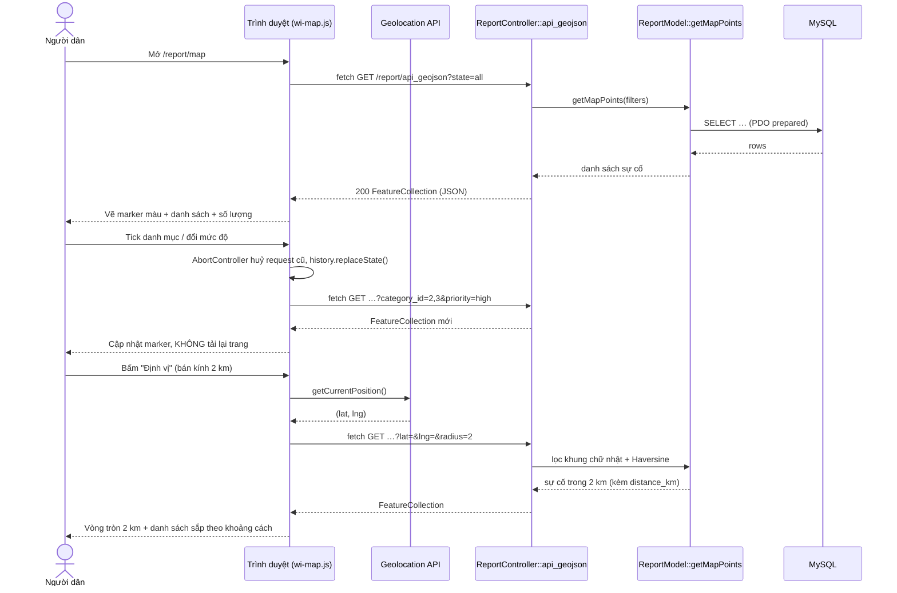

# CHƯƠNG 5 (phần TV1). BẢN ĐỒ SỐ LEAFLET.JS & WEBSERVICE GEOJSON

> **Người soạn:** Khiếu Hoàng Nam Anh (TV1). Nhánh `feature/tv1-system-leaflet-map`, Issue #3 (cùng phụ trách với TV4) và phần kiểm thử bản đồ của Issue #5.
> TV5 ghép mục này vào cuốn Chương 5 hoàn chỉnh. Có thể đánh số lại 5.3 / 5.5 cho khớp với phần WebService của TV3 và AJAX của TV5.

---

## 5.3. Bản đồ số tương tác Leaflet.js

### 5.3.1. Mục tiêu và lựa chọn công nghệ

Từ Milestone 1, mỗi báo cáo đã lưu toạ độ `latitude` / `longitude` (kiểu `DECIMAL(10,7)`) lấy bằng HTML5 Geolocation API. Ở Milestone 3, nhóm trực quan hoá các toạ độ này thành bản đồ điểm nóng để người dân và cán bộ thấy ngay sự cố nằm ở đâu và nghiêm trọng đến mức nào.

| Tiêu chí | Google Maps JS API | **Leaflet.js 1.9.4 + OpenStreetMap** (đã chọn) |
|:---|:---|:---|
| Chi phí / khoá API | Bắt buộc Billing Account (thẻ tín dụng) | Miễn phí, không cần API key |
| Mã nguồn | Đóng | Mã nguồn mở (BSD-2) |
| Dung lượng thư viện | Lớn, tải động | ~42 KB (gzip) |
| Định dạng dữ liệu | Tuỳ biến | Hỗ trợ trực tiếp chuẩn **GeoJSON (RFC 7946)** |

Leaflet được nạp từ CDN jsDelivr **chỉ trên các trang có bản đồ**: controller truyền cờ `use_map => true` cho view, và `layouts/header.php` / `layouts/scripts.php` kiểm tra cờ này. Nhờ vậy các trang khác không phải tải thêm thư viện.

### 5.3.2. Thành phần mã nguồn (đúng mô hình MVC)

| Tầng | Tệp | Vai trò |
|:---|:---|:---|
| Model | `app/models/ReportModel.php` → `getMapPoints()`, `mapLevel()` | Truy vấn sự cố công khai có toạ độ; lọc theo danh mục, mức độ, tình trạng, bán kính (Haversine) |
| Controller | `app/controllers/ReportController.php` → `api_geojson()`, `map()` | Kiểm tra tham số, chuẩn hoá dữ liệu sang GeoJSON; hiển thị trang bản đồ |
| View | `app/views/reports/map.php`, `app/views/home/_map.php`, khối "Vị trí hiện trường" trong `reports/detail.php` | Khung HTML của bản đồ, bộ lọc, danh sách |
| Client | `public/assets/js/wi-map.js`, `public/assets/css/map.css` | Component bản đồ dùng chung: gọi AJAX, vẽ marker, popup, "Sự cố gần tôi" |

Component `wi-map.js` tự khởi tạo mọi phần tử có thuộc tính `data-wi-map` và được cấu hình hoàn toàn bằng `data-*`. Vì vậy cùng một file JS phục vụ được 3 vị trí: **trang chủ** (chỉ hiện sự cố chưa giải quyết), **trang /report/map** (đủ bộ lọc + danh sách) và **trang chi tiết** (1 điểm cố định, không gọi API).

### 5.3.3. Đặc tả WebService `GET /report/api_geojson` 📌

| Tham số | Kiểu | Bắt buộc | Mô tả |
|:---|:---|:---:|:---|
| `category_id` | `int` hoặc danh sách `1,2,3` / `category_id[]=` | Không | Lọc nhiều danh mục cùng lúc |
| `priority` | `low \| medium \| high \| critical` | Không | Mức độ nghiêm trọng |
| `state` | `all` (mặc định) `\| active \| resolved` | Không | `active` = chưa giải quyết; `resolved` = `resolved` + `closed` |
| `lat`, `lng` | `float` | Đi cùng nhau | Tâm lọc "Sự cố gần tôi" (`lat ∈ [-90, 90]`, `lng ∈ [-180, 180]`) |
| `radius` | `float` (km) | Không | Mặc định 5; giới hạn trong khoảng 0,5 – 20 km |

**Quy tắc nghiệp vụ:** chỉ trả báo cáo `is_public = 1`, có toạ độ và **không** ở trạng thái `rejected`. Thông tin liên hệ của người gửi (email, SĐT) **không** bao giờ xuất hiện trong phản hồi.

**Mã phản hồi:** `200` thành công · `405` sai phương thức (chỉ nhận GET) · `422` toạ độ không hợp lệ. Header luôn là `Content-Type: application/json; charset=utf-8`.

**Ví dụ:** `GET /report/api_geojson?lat=10.7765&lng=106.7009&radius=3`

```json
{
  "type": "FeatureCollection",
  "count": 2,
  "filters": { "state": "all", "center": [106.7009, 10.7765], "radius_km": 3 },
  "features": [
    {
      "type": "Feature",
      "id": 1,
      "geometry": { "type": "Point", "coordinates": [106.7009, 10.7765] },
      "properties": {
        "id": 1, "report_code": "WI-20261001-0001",
        "title": "Nước kênh đổi màu bất thường",
        "address": "Quận 3, TP. Hồ Chí Minh",
        "category_id": 2, "category_name": "Ô nhiễm nguồn nước",
        "priority": "high", "priority_label": "Cao",
        "status": "received", "status_label": "Đã tiếp nhận",
        "level": "urgent", "upvote_count": 2, "thumbnail_url": null,
        "detail_url": "http://localhost/Group11_Project-Web_WarningInfo/report/detail/1",
        "distance_km": 0, "incident_time": "2026-10-01 07:30:00"
      }
    }
  ]
}
```

> Lưu ý chuẩn GeoJSON: `coordinates` theo thứ tự **[kinh độ, vĩ độ]**, ngược với Leaflet `[lat, lng]`. `wi-map.js` tự đảo lại khi tạo marker.

### 5.3.4. Phân loại màu Marker

Trường `level` được tính ở server (`ReportModel::mapLevel`), nên client không phải lặp lại logic nghiệp vụ:

| `level` | Điều kiện | Màu | Ý nghĩa |
|:---|:---|:---|:---|
| `resolved` | `status ∈ {resolved, closed}` | 🟢 Xanh `#16a34a` | Đã giải quyết |
| `urgent` | chưa giải quyết **và** `priority ∈ {critical, high}` | 🔴 Đỏ `#dc2626` (có hiệu ứng nhấp nháy) | Khẩn cấp |
| `medium` | các trường hợp còn lại | 🟡 Vàng `#f59e0b` | Trung bình / thấp |

Mỗi marker là một `L.divIcon` hình giọt nước, bên trong có biểu tượng Bootstrap Icons của danh mục (rác, nước, khói, …). Popup xem nhanh gồm ảnh thu nhỏ (nếu chưa có ảnh thì dùng ảnh minh hoạ theo danh mục), mức độ, trạng thái, tên sự cố, địa chỉ, khoảng cách và nút **"Xem chi tiết"**. Mọi chuỗi đều được escape HTML trước khi chèn để chống XSS.

### 5.3.5. Thuật toán "Sự cố gần tôi" (Haversine)

Khoảng cách giữa người dùng `(φ₁, λ₁)` và sự cố `(φ₂, λ₂)` trên mặt cầu bán kính R = 6371 km:

```
d = 2R · arcsin( √( sin²((φ₂−φ₁)/2) + cos φ₁ · cos φ₂ · sin²((λ₂−λ₁)/2) ) )
```

Để truy vấn nhanh, `getMapPoints()` làm hai bước:

1. **Lọc thô bằng khung chữ nhật** bao quanh hình tròn: `Δφ = r/R` (radian), `Δλ = Δφ / cos φ₁`. Điều kiện `latitude BETWEEN … AND longitude BETWEEN …` tận dụng chỉ mục `idx_reports_location (latitude, longitude)`.
2. **Lọc chính xác** bằng công thức Haversine trong SQL (`HAVING distance_km <= :radius`), sau đó sắp xếp từ gần đến xa.

Mọi giá trị (toạ độ, bán kính, danh mục) đều truyền qua **PDO Prepared Statements**, không nối chuỗi SQL.

Phía client, `navigator.geolocation.getCurrentPosition()` lấy vị trí, rồi vẽ chấm xanh (vị trí người dùng) và vòng tròn bán kính 2 / 5 / 10 km. Nếu người dùng chặn quyền vị trí (hoặc trang chạy qua HTTP không phải `localhost`), bản đồ chuyển sang chế độ **"nhấp để chọn vị trí"** thay vì báo lỗi rồi dừng.

### 5.3.6. Sơ đồ tuần tự luồng AJAX của bản đồ



### 5.3.7. Một số quyết định kỹ thuật

- **Đổi tên thuộc tính `data-count` → `data-count-target`:** `main.js` (TV4) đã dùng `[data-count]` cho hiệu ứng đếm số ở trang chủ. Khi bản đồ dùng chung tên này, `main.js` ghi đè "0" vào khung bản đồ và làm mất toàn bộ bản đồ. Lỗi được phát hiện khi kiểm thử tự động và đã sửa bằng cách đổi tên thuộc tính.
- **Không ghi toạ độ người dùng lên URL:** bộ lọc (danh mục, mức độ, tình trạng) được đồng bộ lên URL để chia sẻ link, nhưng `lat` / `lng` thì không, nhằm bảo vệ vị trí cá nhân.
- **AbortController:** khi người dùng đổi bộ lọc liên tục, request cũ bị huỷ để kết quả về sau không ghi đè kết quả mới.
- **Liên kết trang chi tiết → bản đồ lớn:** `/report/map?focus={id}` tự bay tới và mở popup của sự cố đó. Nút "Chỉ đường" mở OpenStreetMap Directions.
- **Responsive:** trên mobile, bản đồ hiển thị trước (60vh), bộ lọc và danh sách xếp bên dưới; trên desktop, bộ lọc là cột trái cố định (sticky). Ở trang chủ và trang chi tiết, cuộn chuột không phóng to bản đồ (`data-no-scroll-zoom`) để không cản trở việc cuộn trang.

---

## 5.5. Kiểm thử bản đồ & WebService GeoJSON (phần TV1 trong Issue #5)

**Môi trường:** PHP 8.3, MariaDB (import `database/database_init.sql`), Chromium headless (Playwright); vị trí GPS giả lập tại 10.7769, 106.7009 (trung tâm TP.HCM). Ngày kiểm thử: 20/10/2026.

### 5.5.1. Kiểm thử API (tương đương Postman)

| # | Yêu cầu | Kết quả mong đợi | Kết quả | Đạt |
|:-:|:---|:---|:---|:-:|
| 1 | `GET /report/api_geojson` | 5 Feature, `type = FeatureCollection` | 5 Feature | ✅ |
| 2 | `?lat=10.7765&lng=106.7009&radius=3` | Sự cố #1 (0 km) và #5 (≈2,7 km), sắp gần → xa | #1: 0 km; #5: 2,73 km | ✅ |
| 3 | `?category_id=2,3&state=active` | #1, #2 | #1, #2 | ✅ |
| 4 | `?state=resolved` | Chỉ #5 | #5 | ✅ |
| 5 | `?lat=abc&lng=1` | HTTP 422 + JSON lỗi tiếng Việt | 422 | ✅ |
| 6 | `POST /report/api_geojson` | HTTP 405 | 405 | ✅ |
| 7 | `radius=999` | Bị giới hạn còn 20 km | `radius_km: 20` | ✅ |
| 8 | Header `Content-Type` | `application/json; charset=utf-8` | Đúng | ✅ |

### 5.5.2. Kiểm thử giao diện chéo (375 / 414 / 768 / 1200 px)

| Kịch bản | 375 | 414 | 768 | 1200 |
|:---|:-:|:-:|:-:|:-:|
| `/report/map` hiển thị đủ 5 marker, không cuộn ngang | ✅ | ✅ | ✅ | ✅ |
| Bấm marker đỏ → popup có ảnh, tên, địa chỉ, nút "Xem chi tiết" | ✅ | ✅ | ✅ | ✅ |
| "Sự cố gần tôi" 2 km → còn 1 sự cố (0,04 km), vẽ vòng tròn | ✅ | ✅ | ✅ | ✅ |
| Tick danh mục "Ô nhiễm nguồn nước" → lọc AJAX, URL cập nhật `?category_id=2&state=all` | ✅ | ✅ | ✅ | ✅ |
| Trang chủ: bản đồ hiện 4 sự cố chưa giải quyết | ✅ | ✅ | ✅ | ✅ |
| Trang chi tiết: bản đồ nhỏ có 1 marker đúng toạ độ | ✅ | ✅ | ✅ | ✅ |
| Link "Xem bản đồ lớn" từ chi tiết #2 → tự mở popup đúng sự cố | — | — | — | ✅ |
| Lỗi JavaScript trên console | 0 | 0 | 0 | 0 |

**Lỗi phát hiện và đã sửa:** xung đột thuộc tính `data-count` với `main.js` khiến bản đồ trống (xem 5.3.7).

### 5.5.3. Ảnh minh chứng (`docs/screenshots/milestone3/`)

| Tệp | Nội dung |
|:---|:---|
| `{w}-11-ban-do.png` | Trang bản đồ toàn màn hình |
| `{w}-12-ban-do-popup.png` | Popup xem nhanh của marker |
| `{w}-13-su-co-gan-toi.png` | Lọc "Sự cố gần tôi" bán kính 2 km |
| `{w}-14-trang-chu-ban-do.png` | Khối bản đồ điểm nóng ở trang chủ |
| `{w}-15-chi-tiet-vi-tri.png` | Thẻ "Vị trí hiện trường" ở trang chi tiết |

(`{w}` ∈ 375, 414, 768, 1200)
