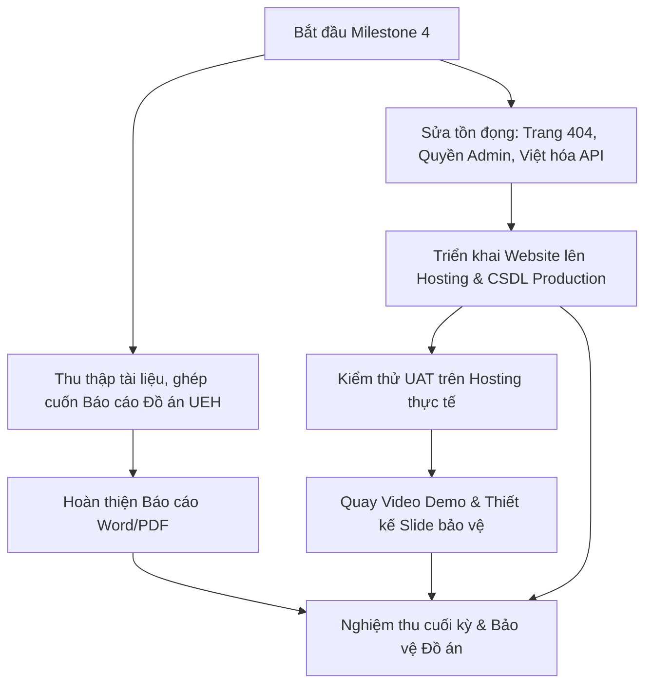

# TRƯỜNG ĐẠI HỌC KINH TẾ TP. HỒ CHÍ MINH (UEH)
## TRƯỜNG CÔNG NGHỆ VÀ THIẾT KẾ – KHOA CÔNG NGHỆ THÔNG TIN KINH DOANH
### Học phần: Phát Triển Ứng Dụng Web
**Giảng viên hướng dẫn:** TS. Đặng Ngọc Hoàng Thành  
**Đề tài:** WarningInfo – Hệ Thống Báo Cáo & Cảnh Báo Vấn Đề Môi Trường Đô Thị  
**Nhóm thực hiện:** Nhóm 11  
**GitHub Repository:** [nvm4nh/Group11_Project-Web_WarningInfo](https://github.com/nvm4nh/Group11_Project-Web_WarningInfo)  

---

# KẾ HOẠCH TRIỂN KHAI & PHÂN CÔNG NHIỆM VỤ GITHUB
## MILESTONE 4: KIỂM THỬ TOÀN DIỆN, TRIỂN KHAI HOSTING & BẢO VỆ ĐỒ ÁN (TUẦN 9 – TUẦN 10)

---

## I. ĐÁNH GIÁ TỔNG QUAN & MỤC TIÊU CỐT LÕI

### 1. Hiện trạng sau Milestone 3
- Đã hoàn thành 100% các tính năng nghiệp vụ trọng tâm:
  - Bản đồ tương tác Leaflet.js, định vị GPS và thuật toán Haversine tính bán kính sự cố gần tôi.
  - Hệ thống WebService RESTful API (JSON/XML) hỗ trợ đầy đủ các tiêu chí lọc, phân trang, upvote, bình luận.
  - Kỹ thuật AJAX toàn diện không tải lại trang ở giao diện người dân, tự động cập nhật URL và chống XSS.
  - Trung tâm quản trị Admin Dashboard trực quan với biểu đồ Chart.js 4.4.1 và xuất dữ liệu CSV UTF-8 kèm BOM.
  - Bàn làm việc cán bộ hiện trường (/officer), phân công xử lý có deadline và cơ chế bảo mật CSRF Token toàn diện.
- Toàn bộ mã nguồn đã được kiểm thử chéo và merge an toàn vào cả nhánh `develop` và `main`.

### 2. Mục tiêu trọng tâm của Milestone 4 (Tiêu chuẩn nghiệm thu Xuất sắc – Điểm 10 UEH)
1. **Triển khai Web Hosting & Tên miền thực tế:** Đưa ứng dụng lên môi trường Production có cấu hình SSL/HTTPS, kết nối CSDL đám mây, tối ưu hóa biến môi trường và thiết lập quyền thư mục upload an toàn.
2. **Xử lý triệt để các tồn đọng kỹ thuật (Polishing & Bug Fixes):**
   - Xây dựng trang hiển thị lỗi 404 Not Found thân thiện thay vì redirect về trang chủ (`core/App.php`).
   - Tối ưu hóa luồng chuyển hướng phân quyền (`requireAdmin()`) khi người dùng không đủ quyền hạn.
   - Đồng bộ hóa toàn bộ thông báo phản hồi của WebService API sang tiếng Việt chuẩn mực.
3. **Kiểm thử nghiệm thu người dùng (UAT) & Đo lường hiệu năng:** Kiểm tra toàn bộ luồng nghiệp vụ trên môi trường Hosting thực tế, đánh giá điểm số Google Lighthouse (Performance, Accessibility, SEO).
4. **Đóng gói Báo cáo Đồ án UEH hoàn chỉnh:** Tổng hợp từ Chương 1 đến Chương 6, hoàn thiện mục lục, tài liệu tham khảo, phụ lục đánh giá đóng góp của từng thành viên theo đúng quy định học thuật của UEH.
5. **Chuẩn bị hồ sơ Bảo vệ Đồ án:** Thiết kế bộ Slide thuyết trình chuyên nghiệp, quay Video Clip Demo hệ thống toàn diện và phát hành bản Release `v1.0.0` trên GitHub.

---

## II. BẢNG PHÂN CÔNG NHIỆM VỤ TỔNG QUAN (NHÓM 11)

| STT | Thành viên | Vai trò chính | Nhánh Git | Module & Nhiệm vụ phụ trách | Thời hạn | Sản phẩm bàn giao |
|:---:|:---|:---|:---|:---|:---:|:---|
| **1** | **Khiếu Hoàng Nam Anh** (TV1) | **Team Lead & DevOps / Deployment** | `feature/tv1-deployment-release` | • Triển khai ứng dụng lên Web Hosting/VPS • Cấu hình SSL, Database Production & .htaccess • Đóng gói GitHub Release v1.0.0 & Quản trị nhóm | Tuần 10 | • URL Website hoạt động trực tiếp • File cấu hình config.production.php • Bản Release v1.0.0 trên GitHub |
| **2** | **Trần Yến Phụng** (TV2) | **Backend Polishing & Presentation** | `feature/tv2-security-presentation` | • Tối ưu hóa bảo mật và kiểm tra quyền admin • Thiết kế Slide thuyết trình bảo vệ đồ án • Rà soát số liệu thống kê Dashboard | Tuần 10 | • Slide thuyết trình (.pptx / Canva) • Cập nhật hàm requireAdmin() và Middleware |
| **3** | **Lê Tố Nguyệt Minh** (TV3) | **API Localization & Video Demo** | `feature/tv3-api-polish-demo-video` | • Việt hóa 100% mã phản hồi WebService API • Kịch bản & Quay dựng Video Demo đồ án • Rà soát tài liệu đặc tả API Chương 5 | Tuần 10 | • Video Demo chất lượng cao (YouTube/Drive) • Bộ mã nguồn API hoàn thiện thông điệp tiếng Việt |
| **4** | **Lê Trọng Hiếu** (TV4) | **Frontend UX Polishing & Security QA** | `feature/tv4-ui-polish-404-page` | • Thiết kế trang lỗi 404 / 500 thân thiện • Tinh chỉnh UI/UX responsive và favicon/SEO • Kiểm tra an toàn upload tệp trên Hosting | Tuần 10 | • Giao diện app/views/errors/404.php • Giao diện lỗi đồng bộ Bootstrap 5.3 |
| **5** | **Nguyễn Thế Luân** (TV5) | **Báo cáo Đồ án UEH & Kiểm thử UAT** | `feature/tv5-final-report-uat` | • Ghép nối toàn bộ cuốn Báo cáo Đồ án UEH • Thực hiện kịch bản kiểm thử UAT trên Hosting • Tổng kết bảng đánh giá đóng góp thành viên | Tuần 10 | • Cuốn Báo cáo hoàn chỉnh (.docx & .pdf) • Biên bản nghiệm thu kiểm thử UAT |

---

## III. DANH SÁCH CHI TIẾT CÁC GITHUB ISSUES CHO MILESTONE 4

### 📌 Issue #36: [TV1] Triển khai hệ thống lên Web Hosting thực tế & Đóng gói Release v1.0.0
* **Assignee:** Khiếu Hoàng Nam Anh (TV1) - [@nvm4nh](https://github.com/nvm4nh)
* **Milestone:** Milestone 4: Kiểm thử toàn diện, Triển khai Hosting & Bảo vệ Đồ án (Tuần 9 – 10)
* **Branch:** `feature/tv1-deployment-release`
* **Labels:** `devops`, `deployment`, `high-priority`
* **Mục tiêu:** Đưa ứng dụng WarningInfo vận hành ổn định trên môi trường Internet thực tế.
* **Danh sách công việc:**
  - [ ] Khởi tạo môi trường Web Hosting (Apache/LiteSpeed, PHP >= 8.1, MySQL/MariaDB) và kích hoạt chứng chỉ SSL miễn phí (Let's Encrypt).
  - [ ] Thiết lập file cấu hình môi trường sản xuất (`config/config.php`): Tự động phát hiện URL hoặc cấu hình tách biệt giữa `localhost` và domain chính thức; tắt `display_errors`.
  - [ ] Import CSDL chuẩn hóa `database_init.sql` và cấu hình tài khoản quản trị mẫu.
  - [ ] Phân quyền thư mục lưu trữ ảnh `public/uploads/` (chmod 755/775) đảm bảo upload ảnh ổn định và ngăn ngừa thực thi mã độc PHP.
  - [ ] Tạo tag và phát hành GitHub Release `v1.0.0` đính kèm tài liệu hướng dẫn bàn giao.

---

### 📌 Issue #37: [TV4] Xây dựng trang xử lý lỗi 404/500 và tinh chỉnh UI/UX hoàn thiện
* **Assignee:** Lê Trọng Hiếu (TV4) - [@hieuhamhoc313-alt](https://github.com/hieuhamhoc313-alt)
* **Milestone:** Milestone 4: Kiểm thử toàn diện, Triển khai Hosting & Bảo vệ Đồ án (Tuần 9 – 10)
* **Branch:** `feature/tv4-ui-polish-404-page`
* **Labels:** `frontend`, `ui-ux`, `enhancement`
* **Mục tiêu:** Nâng cao trải nghiệm người dùng, đảm bảo website xử lý tinh tế khi gặp liên kết hỏng hoặc lỗi hệ thống.
* **Danh sách công việc:**
  - [ ] Nâng cấp Dispatcher `core/App.php`: Khi người dùng truy cập URL không tồn tại, trả về đúng mã trạng thái HTTP 404 (`http_response_code(404)`) thay vì redirect ngầm về trang chủ.
  - [ ] Thiết kế view giao diện trang lỗi đẹp mắt: `app/views/errors/404.php` và `app/views/errors/500.php` theo đúng ngôn ngữ thiết kế Bootstrap 5 của dự án kèm nút "Quay lại trang chủ".
  - [ ] Bổ sung thẻ Meta SEO, OpenGraph (ảnh thumbnail chia sẻ mạng xã hội) và Favicon chuẩn hóa trên toàn hệ thống.
  - [ ] Rà soát căn chỉnh khoảng cách, font chữ và hiệu ứng hover trên toàn bộ các trang.

---

### 📌 Issue #38: [TV3 & TV2] Tối ưu hóa phân quyền Backend & Việt hóa WebService API
* **Assignee:** Lê Tố Nguyệt Minh (TV3) & Trần Yến Phụng (TV2)
* **Milestone:** Milestone 4: Kiểm thử toàn diện, Triển khai Hosting & Bảo vệ Đồ án (Tuần 9 – 10)
* **Branch:** `feature/tv3-api-polish-demo-video`
* **Labels:** `backend`, `security`, `webservice`
* **Mục tiêu:** Hoàn thiện tính toàn vẹn nghiệp vụ Backend và tính thân thiện của API.
* **Danh sách công việc:**
  - [ ] Rà soát và cập nhật helper `core/Controller.php` / `requireAdmin()`: Khi người dùng thông thường hoặc cán bộ truy cập trái phép vào `/admin`, chuyển hướng về trang chủ kèm Flash Alert cảnh báo "Bạn không có quyền truy cập khu vực Quản trị" (thay vì chuyển về trang đăng nhập gây hiểu nhầm).
  - [ ] Đồng bộ hóa toàn bộ các thông điệp phản hồi lỗi của WebService API (`ReportController.php`, `NotificationController.php`, `AdminController.php`) sang tiếng Việt chuẩn ("Phương thức không được hỗ trợ", "Trạng thái không hợp lệ", "Khoảng thời gian không hợp lệ",...).
  - [ ] Kiểm tra ràng buộc dữ liệu: Đảm bảo không thể phân công cán bộ khi sự cố đã đóng (`closed`) hoặc bị từ chối (`rejected`).

---

### 📌 Issue #39: [TV5 & TV1] Hoàn thiện toàn bộ cuốn Báo cáo Đồ án UEH và nghiệm thu UAT
* **Assignee:** Nguyễn Thế Luân (TV5) & Khiếu Hoàng Nam Anh (TV1)
* **Milestone:** Milestone 4: Kiểm thử toàn diện, Triển khai Hosting & Bảo vệ Đồ án (Tuần 9 – 10)
* **Branch:** `feature/tv5-final-report-uat`
* **Labels:** `documentation`, `ueh-report`, `qa`
* **Mục tiêu:** Hoàn thành tài liệu thuyết minh đồ án học thuật đạt tiêu chuẩn cao nhất của Khoa CNTTKD – UEH.
* **Danh sách công việc:**
  - [ ] Hợp nhất các chương thành cuốn Báo cáo Đồ án cuối kỳ hoàn chỉnh (`BAO_CAO_DO_AN_WARNINGINFO_CUOI_KY.docx`):
    - Chương 1: Tổng quan đề tài & Bối cảnh đô thị thông minh.
    - Chương 2: Phân tích yêu cầu, Use Case & Thiết kế CSDL (3NF).
    - Chương 3: Kiến trúc MVC và Hiện thực hóa lõi hệ thống.
    - Chương 4: Quản trị sự cố, Bàn làm việc cán bộ & An ninh CSRF.
    - Chương 5: Bản đồ tương tác Leaflet, WebService RESTful, AJAX & Báo cáo QA Testing (từ 2 file draft của M3).
    - Chương 6: Triển khai môi trường Hosting, Đánh giá kết quả & Hướng phát triển.
  - [ ] Chèn đầy đủ Mục lục tự động, Danh mục hình ảnh, Danh mục bảng biểu và Tài liệu tham khảo theo quy chuẩn UEH.
  - [ ] Lập Bảng tự đánh giá tỷ lệ hoàn thành và đóng góp công việc của 5 thành viên (100% công bằng, minh bạch).
  - [ ] Thực hiện kiểm thử nghiệm thu UAT trên đường link Hosting thực tế, lập biên bản nghiệm thu đính kèm phụ lục.

---

### 📌 Issue #40: [TV2 & TV3] Xây dựng Slide Thuyết trình & Sản xuất Video Demo hoàn chỉnh
* **Assignee:** Trần Yến Phụng (TV2) & Lê Tố Nguyệt Minh (TV3)
* **Milestone:** Milestone 4: Kiểm thử toàn diện, Triển khai Hosting & Bảo vệ Đồ án (Tuần 9 – 10)
* **Branch:** `feature/tv2-security-presentation`
* **Labels:** `presentation`, `video-demo`, `admin`
* **Mục tiêu:** Chuẩn bị tư liệu truyền thông và phương tiện thuyết trình bảo vệ đồ án trước Hội đồng / Giảng viên.
* **Danh sách công việc:**
  - [ ] Thiết kế Slide thuyết trình bảo vệ đồ án (khoảng 20 – 25 slides):
    - Đặt vấn đề & Mục tiêu giải pháp.
    - Kiến trúc công nghệ (MVC thuần, Leaflet.js, AJAX, WebService, Chart.js).
    - Luồng quy trình tương tác 3 bên (Người dân – Cán bộ – Admin).
    - Demo các tính năng nổi bật.
    - Kết quả đạt được & Bài học kinh nghiệm.
  - [ ] Quay và biên tập Video Clip Demo hoàn chỉnh (thời lượng 5 – 7 phút):
    - Kịch bản xuyên suốt: Người dân chụp ảnh gửi sự cố có GPS → Xem vị trí trên Bản đồ tương tác → Quản trị viên duyệt và phân công có hạn chót → Cán bộ hiện trường nhận việc và cập nhật tiến độ → Người dân nhận thông báo tức thì, thả Upvote và bình luận tương tác.
    - Thuyết minh tiếng Việt rõ ràng, chèn phụ đề và nhạc nền phù hợp.
    - Xuất video Full HD 1080p và upload lên YouTube / Google Drive chia sẻ công khai.

---

## IV. LỘ TRÌNH THỰC HIỆN MILESTONE 4 (TUẦN 9 – TUẦN 10)

### Chi tiết phân bổ theo tuần:
* **Tuần 9 (Hoàn thiện mã nguồn & Triển khai):**
  - Ngày 1 – 3: Giải quyết các lỗi B2, B3, B4; tạo trang 404, việt hóa API, tối ưu middleware.
  - Ngày 4 – 5: Cấu hình Web Hosting, import Database, kết nối tên miền và cài đặt chứng chỉ SSL.
  - Ngày 6 – 7: Kiểm thử toàn diện trên Hosting (UAT), đo kiểm Lighthouse và tốc độ phản hồi.
* **Tuần 10 (Đóng gói học thuật & Bảo vệ):**
  - Ngày 1 – 3: Ghép nối và hoàn thiện 100% cuốn Báo cáo Đồ án bản Word / PDF chuẩn UEH.
  - Ngày 4 – 5: Hoàn thành Slide thuyết trình và dựng Video Demo nghiệp vụ.
  - Ngày 6 – 7: Phát hành GitHub Release `v1.0.0`, tổng duyệt thuyết trình và sẵn sàng bảo vệ đồ án.

---

## V. TIÊU CHÍ ĐÁNH GIÁ ĐỒ ÁN XUẤT SẮC (CHUẨN ĐIỂM 10 UEH)

1. **Tính hoàn chỉnh & Ổn định:** Website vận hành trơn tru trên Hosting thực tế, không có lỗi PHP Warning/Notice, không có lỗi Javascript trên Console.
2. **Tuân thủ Kiến trúc:** Mô hình MVC PHP thuần tách bạch rõ ràng giữa Model, View, Controller; an toàn bảo mật (CSRF, PDO Prepared Statement, XSS Filtering).
3. **Tính ứng dụng cao:** Kết hợp xuất sắc giữa Bản đồ số Leaflet.js, Kỹ thuật AJAX mượt mà và Biểu đồ thống kê Chart.js.
4. **Hồ sơ minh bạch:** Quản lý dự án chuyên nghiệp trên GitHub (Issues, Pull Requests, Milestones rõ ràng theo từng thành viên).
5. **Chất lượng Báo cáo & Thuyết trình:** Văn phong học thuật chuẩn mực, bố cục rõ ràng, slide trực quan và video thuyết minh thuyết phục.

---

## VI. KẾT QUẢ THỰC HIỆN (CẬP NHẬT 13/11/2026)

| Issue | Nội dung | Kết quả |
|:---:|:---|:---|
| #36 | Triển khai Hosting & Release | Website chạy tại https://warninginfo.infinityfree.io/ với `config/config.local.php` tách khỏi Git. Chưa tạo tag Release `v1.0.0`. |
| #37 | Trang lỗi 404/500, SEO, favicon | Hợp nhất qua PR #46 và PR #49 (`fix/tv4-error-page-hardening`). |
| #38 | Phân quyền & Việt hóa API | Việt hóa thông báo API qua PR #41; chuyển hướng khi không đủ quyền qua PR #42. |
| #39 | Báo cáo đồ án & UAT | Kiểm thử 42/42 ca trên hosting, xem [docs/test-report/test-report.md](test-report/test-report.md). |
| #40 | Slide & Video Demo | Theo dõi trên Issue #40. |
